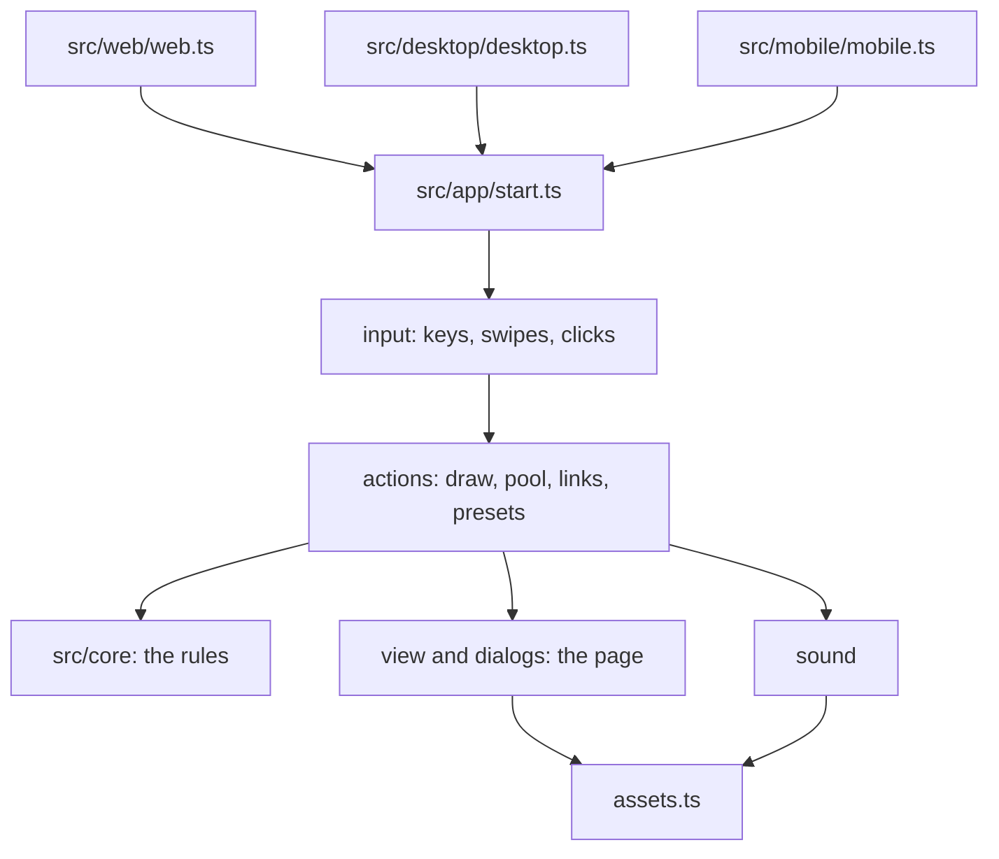

# Fresh Random Civ Picker: maintainer's guide

1. [Add a new civ](#add-a-new-civ)
2. [How the code works](#how-the-code-works)
   - [Files and folders](#files-and-folders)
   - [Diagram](#diagram)
   - [One core, one interface, three shells](#one-core-one-interface-three-shells)
   - [The shared context](#the-shared-context)
   - [Data and assets](#data-and-assets)
   - [The build](#the-build)
   - [Packages and their versions](#packages-and-their-versions)
   - [The pages and simple mode](#the-pages-and-simple-mode)
   - [Tests](#tests)
   - [Rules for changing the code](#rules-for-changing-the-code)

## Add a new civ

You need [Node.js](https://nodejs.org/) 24 or newer, the civ's icon as a WebP image of 104 by 104 pixels, and its
jingle as a WebM sound. Run `npm ci` once in the project's folder before the first time. The example adds a civ
named "Example" from the DLC "sagas".

1. **Give the civ its ID.** Open `assets/data.json` and add a line to `civs`, where the name falls in the alphabet:
   `{"id": 56, "name": "Example", "dlc": "sagas"},`. The ID is the highest ID in the file plus one. Never change or
   reuse an ID: share links and saved draw logs refer to civs by ID. The name is one word. If aoe2techtree.net
   calls the civ something else, add `"techTree": "ThatName"`.
2. **Add its files.** Make the folder `assets/civs/example/` (the name in lower case) and put in it `example.webp`
   (the icon) and `example.webm` (the jingle). `example.txt`, the civ's history for the desktop's History dialog, is
   optional. Only a civ of an edition with `"legacyJingles": true` also needs `example_legacy.webm`.
3. **A new DLC?** Then first add it to `dlcs` in `assets/data.json` with its `name`, `short` name, `edition`, `icon`
   and `released` date, add its key to its edition's `dlcToggles`, and put its icon, 128 by 128 pixels, at
   `assets/dlcs/<icon>/<icon>.webp`.
4. **Rebuild the atlases:** `npm run atlas`. It prints one line per atlas, ending in the grid it now has, such as
   `--cols: 8; --rows: 8;`. If a line differs from what `src/web/styles/parchment.css` gives for `.civ-cell`,
   `.dlc-cell` or `#editionIcon`, change the numbers there to match.
5. **Freeze the ID.** Add `"Example"` at the end of `tests/fixtures/civ-ids.json`. That list holds every civ's name
   in ID order, so that a test fails if an ID ever moves.
6. **Run the tests:** `npm test`. Every line should start with `✔`. The message of a failing test names the civ or
   the file that is wrong, such as a missing icon.
7. **Look at it:** `npm run web`, open `http://127.0.0.1:8080/`, find the civ on the Civ Pool tab and draw until it
   comes up. Stop with Ctrl+C.
8. **Record the change** in the last part of `docs/DEVLOG/`, and commit.

A share link has room for 64 civs. The civ with ID 64 needs a new link format in `src/core/share.ts` first; a test
fails to say so.

## How the code works

The picker is written once, in TypeScript, and runs on three platforms: the web, the desktop and Android. Node.js
runs the `.ts` files as they are, so there is no compile step for the tests or the scripts; the build only bundles
the code into one `script.js` for each platform's site.

### Files and folders

| File or folder | What it holds |
| --- | --- |
| `src/core/` | The core: the picker's rules, without any page. Civ data, the state, drawing, share links, presets. |
| `src/app/` | The shared interface: everything that shows the picker and takes input. Its folders are listed below. |
| `src/web/` | The web's shell `web.ts`, the pages (`pages/`), every platform's style sheets (`styles/`), and files copied into the web site as they are (`site/`). |
| `src/desktop/` | The desktop's shell: the Electron main process, its preload script and the entry file. See [DESKTOP.md](desktop/DESKTOP.md). |
| `src/mobile/` | The mobile shell: the entry file for Capacitor and the script that prepares the Android project. See [MOBILE.md](mobile/MOBILE.md). |
| `src/tsconfig.json` | The TypeScript settings, for `src/`, `tests/` and `scripts/`. |
| `assets/` | The data (`data.json`), images, sounds and history texts, the same for every platform. |
| `scripts/` | `build.ts` builds the sites, `serve.ts` serves one, `atlas.ts` rebuilds the atlases, `tests-doc.ts` writes `TESTS.md`. |
| `tests/` | The tests, a folder per area, their fixtures in `fixtures/` and their notes for `TESTS.md` in `test-notes.json`. |
| `docs/` | This guide, the platform guides in `web/`, `desktop/` and `mobile/`, `RULES.md`, `REQUIREMENTS.md`, `TESTS.md`, `DECISIONS.md`, `TERMINOLOGY.md`, and the development log in `DEVLOG/`. |
| `package.json`, `package-lock.json` | The commands (`npm run ...`), the packages the project uses and their exact versions, and how the desktop program is packed. |
| `capacitor.config.json` | The Android app's ID, name and site folder. |
| `README.md` | Introduces the project. |
| `LICENSE` | The terms under which anyone may use the project. |
| `AGENTS.md` | What an AI agent must know before it changes anything here: what to read first, what it must never do, and when a change is done. |
| `.claude/CLAUDE.md` | The same for Claude Code, which reads this file by itself. It loads `AGENTS.md` and `RULES.md`. |
| `.claude/skills/` | Step-by-step procedures for AI agents, one folder each, such as how to write the development log. `ub-mode` is copied from another project and keeps its licence beside it. |
| `.claude/settings.json` | Stops Claude Code from committing and from changing `REQUIREMENTS.md`. |
| `.github/` | What GitHub shows contributors: how to contribute, report a bug or a security hole, and the pull request form. |
| `.github/workflows/checks.yml` | Tells GitHub to run the checks and the tests on every push and pull request. |
| `.github/scripts/check-rules.sh` | Checks the rules a script can check; see [Tests](#tests). |
| `.gitattributes`, `.gitignore` | How Git treats line endings, and which files it leaves out (`node_modules/`, `dist/`, `android/`, `release/`). |

The folders of the shared interface, `src/app/`:

| Folder or file | What it holds |
| --- | --- |
| `start.ts` | `start(platform)`: loads the data, fills the shared context, builds and wires the page. Every shell calls it. |
| `platform.ts`, `browser.ts` | What differs between platforms, as an interface, and the browser's way of doing each thing. |
| `context.ts` | The shared context `ctx`. |
| `assets.ts` | The address of every asset. No other file builds an asset's address. |
| `model/` | The hotkey tables and texts, the settings and saving, helpers for the current state, tooltip texts. |
| `actions/` | What the picker can do: draw, reset, undo, change the civ pool, share links, presets, links out. `actionmap.ts` names every action. |
| `view/` | Building and updating the page: the tabs, the draw logs' scrollbars, menus, tooltips, simple mode. |
| `dialogs/` | The dialogs: Options, Hotkeys, About and the others; on the desktop also Customise Hotkeys. |
| `input/` | Keys, swipes and clicks, and `wiring.ts`, which connects the page to the actions. |
| `sound/` | Playing jingles and the interface's sounds, and loading the next ones ahead. |
| `bindings/`, `desktopui/`, `history/` | The desktop's hotkeys that can be changed, its own menus, buttons and tooltips, and the History dialog. |
| `mobileui/` | The mobile app's own menu items, About texts and labels. |

### Diagram



Every part also reads the shared context, and reaches what differs between platforms through `ctx.platform`.

### One core, one interface, three shells

A shell is a few lines: it makes a `Platform` object and calls `start` with it. The web's is the whole of
`src/web/web.ts`:

```ts
import { browserPlatform } from "../app/browser.ts";
import { start } from "../app/start.ts";

start(browserPlatform);
```

The desktop and the mobile shell copy `browserPlatform` and replace what they do differently: `kind` (`"web"`,
`"desktop"` or `"mobile"`), the address share links start with, how a link is shared, how a preset is saved, how the
app is left, and how a share link reaches the app at start (`launchCode`) and while it runs (`onLink`). So a
difference between platforms belongs in a shell, or in `src/app/` behind a check of `ctx.platform.kind`; the web
must not change when a desktop or mobile part is added.

`start` writes the kind on the page as `data-platform`, which the style sheets use: a desktop-only rule starts with
`:root[data-platform="desktop"]`.

Every platform keeps its settings, state and quicksave in the page's `localStorage`, under `frcp.settings`,
`frcp.state` and `frcp.quicksave`, in the same form.

### The shared context

`src/app/context.ts` exports one object, `ctx`, which `start` fills once: the data's rules (`ctx.logic`), the state
(`ctx.state`), the settings, the platform, the page's elements and the table of actions.

- **Nothing in `src/app/` may use `ctx`, or call another module, while the files are being loaded**: the modules
  import each other in circles, which only works when everything happens inside functions that run after `start`.
- **Always read `ctx.state` and `ctx.settings` through `ctx`.** Loading a quicksave or a change in another browser
  tab replaces them, so a copy kept in a variable goes stale.
- **The state** is `{ edition, off, log }`: the edition, the IDs of the civs that are off, and the draw log, a list
  of rounds, each a list of draws `[civ id, k, n]` shown as "Civ (k/n)". The last round is the current one.

### Data and assets

`assets/data.json` holds the editions, the DLCs and the civs. An edition has its own civs and those of every older
edition. A share link stores an edition by its place in the list, so a new edition goes at the end.

No folder may hold more than 7 files, so each civ, edition and DLC has a folder of its own:

```
assets/civs/britons/britons.webp          the icon, 104 x 104
assets/civs/britons/britons.webm          the jingle
assets/civs/britons/britons_legacy.webm   the legacy jingle, for civs of an edition with legacyJingles
assets/civs/britons/britons.txt           the history, for the desktop's History dialog
assets/editions/de/                       de.webp, de_hover.webp, de_pressed.webp, de_wide.webp
assets/dlcs/khans/khans.webp
assets/atlases/                           the three atlases that scripts/atlas.ts builds from the icons above
assets/ui/                                the interface's images by kind, and its sounds
assets/launcher/                          the Android and desktop program icons
```

The atlases put the civ icons in ID order with "random" last, and each edition's three looks before the DLC icons;
`src/app/model/hotkeytables.ts` (`CIV_ATLAS_COLS`, `DLC_ATLAS_COLS`) and `parchment.css` (`--cols`, `--rows`) must
agree with them, which a test checks.

### The build

`npm run build` runs `scripts/build.ts`, which makes one site per platform in `dist/`, which Git leaves out:

```
dist/web/index.html              from src/web/pages/picker.html
dist/web/simple/index.html       from src/web/pages/simple.html
dist/web/civexplorer/index.html  from src/web/pages/civexplorer.html
dist/web/script.js               the platform's shell and everything it imports, bundled by esbuild
dist/web/styles/                 from src/web/styles/
dist/web/assets/                 from assets/
```

`dist/desktop/` and `dist/mobile/` are the same with their own `script.js`; the desktop's also has `main.js` and
`preload.cjs`, the Electron process. `node scripts/build.ts web` builds one platform only.

The script finds its assets from the folder of the `<script src="...script.js">` tag, so the bundle must keep the
name `script.js` and stay at the site's top.

### Packages and their versions

`package.json` names the packages the project uses, and `package-lock.json` the exact version of each one and of the
packages they use in turn. `npm ci` installs exactly those, and must end with `found 0 vulnerabilities`. To check and
update:

1. **Look for known faults.** `npm audit` lists every package with a known security fault, and which package asks
   for it.
2. **Look for newer versions.** `npm outdated` lists the project's own packages that have a newer version.
   `electron-builder` may show there with a "Latest" older than "Current"; that is not a fault.
3. **Update.** `npm update` takes the newest versions `package.json` allows; `npm install <package>@latest` goes past
   that. Both rewrite `package-lock.json`.
4. **Check.** Run `npm ci`, `npm test` and `npm run package`; the last one shows that the desktop program still packs.

A fault in a package that another package asks for cannot be mended by updating, when the asking package is already
the newest. Then `overrides` in `package.json` names the version to use instead:

- `minimatch` 11 for `app-builder-lib`, the part of `electron-builder` that asks for the faulty 10. The two packages
  under it that need the old `minimatch` 3, `glob` 7 and `dir-compare`, are named there to keep it.
- `global-agent` 4, as version 3 uses a package that is no longer kept up.

Take an override away when the asking package no longer asks for the faulty version: remove it, run `npm install`,
and see that `npm audit` still finds nothing.

`npm ci` still warns that `glob` 7, `inflight` and `rimraf` 2 are deprecated. `electron-builder` asks for them and
does not work with their newer versions; `npm audit` knows of no fault in the versions installed.

### The pages and simple mode

- **`picker.html` is close to the limit of 400 lines.** What only one platform shows is therefore built from
  TypeScript, with `h()` from `view/domhelpers.ts`, not added to the page.
- **Simple mode has no page of its own.** `simple.html` fetches the picker's page, marks it with `data-simple`, adds
  `simple.css` after the line `<link rel="stylesheet" href="styles/phone.css">` and writes the result. That line
  must stay in `picker.html` exactly so, as the last style sheet.
- **A style rule that loads an image** must not apply in simple mode, which loads none: scope it with
  `:not([data-simple])`. A test checks every style sheet for this.
- **The phone layout** is the rules under `@media (max-width: 609px)` in `phone.css`. Elements with the class `mob`
  show only there, those with `desk` only on wider screens.
- **The program icon in `parchment.css`** is an image written out as text over several lines that end in `\`. The
  lines after the first must start at the very left.

### Tests

Run the tests with `npm test`. It builds the web site first, as the page tests open it. GitHub runs them on every
push and pull request; a green tick in the repository's **Actions** tab means they all passed.

| Folder | What its tests check |
| --- | --- |
| `tests/core/` | The core: the data and its files, drawing, the saved state, share links and presets, against files written by earlier versions in `tests/fixtures/`. |
| `tests/desktop/` | The desktop's hotkeys that can be changed, and the History dialog's search. |
| `tests/mobile/` | The mobile shell: incoming links, the back button, sharing, the changes to the Android project. |
| `tests/page/` | The built web site in a real browser: the phone's swipes. `chrome.ts` finds and drives the browser. |
| `tests/simple/` | Simple mode against WCAG 2.2 at level AAA, in the same browser, with axe-core from `vendor/`. |
| `tests/structure/` | Rules 10 and 11: no comments in the code, no function over 60 lines. |

- **The page tests need Chrome, Edge or Chromium.** They find it by itself, or at `CHROME_PATH`. Without a browser,
  or with `FRCP_NO_BROWSER` set, they are skipped, not failed.
- **The functions in `tests/simple/checks/` run inside the page**, not in Node. They are sent there as text, so they
  may only use each other and the page. A new one must be added to the list at the end of its file, or the page will
  not know it.
- **The last test of `wcag.test.ts` must stay last**: it reports the errors every test before it met.
- **The preset fixtures keep their Windows line ends**, which `.gitattributes` protects: presets are compared byte
  for byte.
- **`TESTS.md` is written by a script.** After adding, removing, renaming or moving a test, give it a note in
  `tests/test-notes.json` (its category, purpose and what must hold), then run `npm run tests-doc`. It numbers the
  tests in the order they run, writes each number into the test's name, and writes `TESTS.md` with every test's file
  and lines. So a test is always written as `test("its name", ...` on one line, at the left edge, and ends with a
  line starting `});`.

There may be at most 100 tests, and there are 100: a new test replaces one worth less. Each test makes one check.

GitHub also runs `.github/scripts/check-rules.sh`, which checks what a script can check without knowing the language of
the code: that no folder holds too many files, that no two files share a name, that no line or file of code is too long,
that the development log keeps its form, and that `TESTS.md` numbers its tests 1, 2, 3 and so on. Run it yourself before
you commit, from the project's folder:

```
bash .github/scripts/check-rules.sh
```

On Windows, run it in Git Bash. Each line says `ok`, `skip`, `todo` or `FAIL`, and every `FAIL` names the file and the
rule. A `todo` does not fail: it lists the placeholders, names in double braces, still to fill in from the template.

`npm run check` checks the types of all the code without running it.

AI agents write code by `ub-mode`, which runs three tools that are not part of the project: crapper, which scores
each function by how complex it is and how much of it the tests run; dryer, which finds code written twice; and
mutator, which changes the code on purpose to see whether a test notices. They need Python 3.11 or newer; for C also
gcc, CMake and gcovr (`pip install gcovr`), and on Windows Ninja. To have them, clone them once next to the project's
folder, in Git Bash:

```
cd ..
git clone https://github.com/cnordenb/crapper
git clone https://github.com/cnordenb/dryer
git clone https://github.com/cnordenb/mutator
```

The first run of each sets itself up. What they write in the project, `.metrics/` and `target/`, Git leaves out.
`AGENTS.md` lists the languages they work for.

### Rules for changing the code

`RULES.md` has the full list; the tests and `check-rules.sh` check most of it.

- No file over 400 lines of code, no function over 60, and no line over 120 characters. Pages and style sheets are
  code too.
- No folder over 7 files, except `docs/DEVLOG/`; the main folder may hold 8, and holds 8.
- No two files with the same name, except `SKILL.md`. So there is one `index.html` only in the built sites, and the
  pages have their own names in `src/web/pages/`.
- No comments in the code. Explain what needs explaining in this guide instead.
- Only what TypeScript can simply strip away: no `enum`, no `namespace`. Imports end in `.ts`.
- `REQUIREMENTS.md` defines what the project does, and only the chief developer may change it.
- Record what you change, and why, in the last part of `docs/DEVLOG/`, under the day's date, and list any
  decision in `DECISIONS.md`.
- Only humans commit. AI agents leave their work for a human to read, test and commit.
